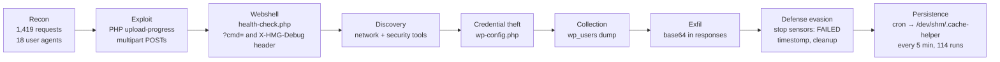

# PHP2Shell: The Hartwell Breach — Threat Hunt

    

> **Lab exercise.** This hunt was run on a LOG(N) Pacific cyber range. "Hartwell Medical Group" is a fictional organization, and all hosts, accounts and credentials belong to the lab. Credentials are redacted below anyway, as they would be in a real report.

**Analyst:** Tural Aghabalayev, SOC Analyst · **Workspace:** `LAW-HuntPractice` (Log Analytics / KQL) · **Incident date:** 23 October 2026 · **All times UTC**

---

## Contents

1. [The story in 60 seconds](#1-the-story-in-60-seconds)
2. [The environment](#2-the-environment)
3. [The attack, step by step](#3-the-attack-step-by-step)
4. [How the hunt uncovered it](#4-how-the-hunt-uncovered-it)
5. [The twist: the attacker's IP also built the lab](#5-the-twist-the-attackers-ip-also-built-the-lab)
6. [Timeline](#6-timeline)
7. [MITRE ATT&CK mapping](#7-mitre-attck-mapping)
8. [Detections I wrote](#8-detections-i-wrote)
9. [Indicators of compromise](#9-indicators-of-compromise)
10. [What I'd tell the client to do](#10-what-id-tell-the-client-to-do)
11. [What I learned](#11-what-i-learned)

---

## 1. The story in 60 seconds

**The analogy.** Imagine a clinic's front desk has a "drop your forms here" tray. Someone slips a form into the tray that isn't really a form. It's a set of instructions, and the clerk follows them. Now the stranger can pass notes through the tray all day: "read me the safe combination," "copy the patient list," "make a spare key and hide it under the mat." That's this incident.

**What actually happened.** An attacker at `192.168.1.100` abused PHP's file-upload progress feature on Hartwell's patient-facing WordPress server (`192.168.1.120`). That gave them a **webshell**, a small PHP page that runs whatever command you send it. The page was disguised as a harmless health check: `/var/www/html/health-check.php`.

Through that webshell, running as the web server account `www-data`, the attacker:

- 🔎 **looked around:** mapped the network and checked which security tools were running
- 🔑 **stole the keys:** read `wp-config.php`, which holds the database password and WordPress secret keys
- 📋 **copied the user list:** dumped the `wp_users` table (usernames, emails, password hashes)
- 📦 **smuggled it out:** base64-encoded the data and sent it back inside the webshell's responses
- 🙈 **tried to blind the cameras:** tried to stop Sysmon, auditd and the Splunk forwarder, **and failed**
- 🧹 **covered tracks:** back-dated the webshell's timestamp and deleted staging files
- 🔁 **made sure they could come back:** planted a program in RAM (`/dev/shm/.cache-helper`) and a cron job that relaunched it **every 5 minutes, 114 times**

No lateral movement to other machines was found.

---

## 2. The environment

| Item | Value |
|---|---|
| Victim server | `192.168.1.120` (`debian13`): WordPress 7.1.3, Apache 2.4.69, PHP 8.4.4 |
| Attacker | `192.168.1.100`, a private address inside the same /24, rotating **18 user agents** |
| Hunt window | 23 Oct 2026, 04:00–16:00 UTC |

**Log sources I used, and what each one can and can't see:**

| Table | Think of it as… | Good for | Blind to |
|---|---|---|---|
| `HartwellApache_CL` | The visitor sign-in sheet | Every URL requested, including `?cmd=` payloads | Custom headers |
| `HartwellHTTPEnriched_CL` | A transcript of every conversation at the door (from packet capture) | Full headers, multipart boundaries, decoded commands | Response size |
| `HartwellApacheError_CL` | The complaints box | PHP warnings when something odd hits the server | Whether an exploit worked |
| `HartwellSysmon_CL` | Security camera on every program | Which process started which process, and as whom | File writes in the webroot, `/tmp`, `/dev/shm` |
| `HartwellAudit_CL` | The building's master key-card log | **The most trustworthy clock.** Every program run, file write, SSH login and sudo command | File contents; some fields are hex-encoded |

> 💡 **Lesson from the first query:** the console showed times in EDT (UTC−4), even when I filtered in UTC. I proved it with an audit record whose raw Unix timestamp (`1792730071` = 04:34:31 UTC) displayed as 12:34:31 AM. Every screenshot time in this hunt is shifted +4 hours. Catching that early kept the whole timeline honest.

---

## 3. The attack, step by step



### Step 1: Reconnaissance, a noisy scan from one address
`192.168.1.100` sent **1,419 requests** (the brief said "over 1,500"; I counted). It rotated through **18 different user agents**, a cheap trick to look like many different visitors. Because the user agent changed constantly, my detections key on **behavior**, not on the user-agent string.

### Step 2: Initial access, abusing PHP's upload-progress feature
PHP has a feature called `session.upload_progress`. When you upload a file, PHP keeps notes in your session about how far along the upload is. The attacker sent specially crafted **multipart POST** requests (the format browsers use to upload files) to reach that code.

How I could tell it was a tool and not a person: three of the eight exploit POSTs carried the same multipart **boundary string**, the divider line between the parts of an upload:

```
Content-Type: multipart/form-data; boundary=----0x4148php2shell
```

Browsers generate random boundaries. A boundary that literally says `php2shell` is a tool's fingerprint.

### Step 3: The webshell, two ways to send commands
The attacker controlled `health-check.php` through **two channels**:

**Channel 1: a plain URL parameter.** Easy to see in the Apache log:
```
GET /health-check.php?cmd=id
GET /health-check.php?cmd=whoami
```

**Channel 2: a hidden header.** This channel **never appears in the Apache access log**, because Apache doesn't log custom headers. I only found it in the packet-derived HTTP table. The commands travel in an `X-HMG-Debug` header, encoded twice: first **rot13** (shift every letter 13 places), then **base64**.

Here's a worked example of peeling it back:

```
Header value seen on the wire:   ZmxmZ3J6...
Step 1, base64 decode   →        flfgrz...
Step 2, rot13 decode    →        system...
```

So `ZmxmZ3J6` is just the word `system` (PHP's "run this command" function) in disguise. That made it a perfect detection anchor: **any request containing `ZmxmZ3J6` is someone calling `system()` through this channel.**

> 🔎 **Detection tip I learned the hard way:** search for this string with KQL `contains`, not `has`. `has` only matches whole words, so it can never find `ZmxmZ3J6` buried inside a longer base64 string.

> 🔑 **Why this matters:** an analyst who only checked the web server log would have seen the `?cmd=` traffic and missed most of the attack. Cross-checking a second data source is what exposed the hidden channel.

### Step 4: Discovery
Through the shell, the attacker ran `id` and `whoami` (answer: `www-data`), mapped the network, and looked for security tools such as Sysmon, auditd and Splunk. At 12:24 they also listed `/home/debian/.ssh/`, looking for SSH keys belonging to the server's admin account.

### Step 5: Credential theft
They grepped and printed `wp-config.php`:
```
grep DB_ wp-config.php        # database name, user, password
grep AUTH wp-config.php       # WordPress secret keys and salts
```
That file holds the database password (`[redacted]`) and the keys WordPress uses to sign login cookies. With those, an attacker can read the database and forge sessions.

> I mapped this to **T1552.001 (Credentials in Files)**, not the platform's suggested T1555 (Credentials from Password Stores). A plain config file is not a password store.

### Step 6: Collection and exfiltration
They dumped the `wp_users` table (logins, emails, password hashes), staged the data in `/tmp/.backup.tar.gz`, then **base64-encoded it and read it back through the webshell's HTTP responses.** There was no separate upload server; the data left in the same channel the commands came in on.

### Step 7: Defense evasion, which failed
The attacker tried to switch off the monitoring:
```
auditctl -D                     # wipe audit rules
systemctl stop <sysmon>         # ×3, for Sysmon, auditd, Splunk forwarder
```
**Every attempt failed.** They were running as `www-data`, not root, and you need root to stop system services. The sensors kept recording, which is why this report has no blind spots after that point.

They also **timestomped** the webshell with `touch -r`, copying the timestamp of an old legitimate file so the shell would look like it had always been there, and deleted their staging files.

### Step 8: Persistence, a program that lives in RAM
`/dev/shm` is a folder that lives in memory, not on disk, so anything there disappears on reboot and is easy to overlook. The attacker put an executable there named `.cache-helper` (the leading dot hides it from a normal `ls`) and installed a **www-data cron job** to relaunch it **every 5 minutes**. Audit logs show it ran **114 times**.

> ⚠️ **Correction to the case notes:** the brief said `.cache-helper` was a renamed copy of `/usr/bin/sleep`. The audit log shows that was only true from 14:15:49 onward. Earlier it was a copy of a downloaded binary, `/tmp/.update` (04:36:21), and later a fresh download (12:25:23). Trusting the brief would have understated the implant.

---

## 4. How the hunt uncovered it

This is the part I'm proudest of. Each finding came from a specific question and a specific query.

| # | Question I asked | Where I looked | What I found |
|---|---|---|---|
| 1 | Who is noisiest? | `HartwellApache_CL`, count by `SourceIP` | `.100` with 1,419 requests and 18 user agents |
| 2 | Is anyone running commands through a PHP page? | Apache URIs matching `\.php\?cmd=` | `health-check.php?cmd=id`, `whoami`, `curl`, `chmod`, `nohup` |
| 3 | Does the web server start shells? It never should. | Sysmon: parent `apache2` → child `sh`/`bash`/`dash` | Every hit ran as `www-data`, during the incident window only |
| 4 | Is there traffic the access log can't see? | `HartwellHTTPEnriched_CL` headers | The `X-HMG-Debug` channel, decoded via rot13 + base64 |
| 5 | How did they get in? | Multipart POSTs + PHP error log | 8 exploit POSTs, 3 with the `php2shell` boundary; PHP session warnings |
| 6 | What did they touch? | Sysmon command lines from `www-data` | `wp-config.php` reads, `wp_users` dump, base64 pipes |
| 7 | Did they try to hide? | Sysmon for `systemctl stop`, `auditctl -D` | Three failed sensor shutdowns; `touch -r` timestomp |
| 8 | Will they come back? | Audit log: PHP worker running binaries from `/tmp` or `/dev/shm` | Cron → `/dev/shm/.cache-helper`, 114 runs |
| 9 | Do the clocks agree? | Apache vs. auditd timestamps | They didn't, which led to the twist below |

**Example: the query that proved the web server was spawning shells** (Step 3 above):

```kql
HartwellSysmon_CL
| where RuleName == "ProcessCreate"
| where ParentImage endswith "/apache2"
| where Image in ("/usr/bin/dash", "/bin/dash", "/bin/sh", "/usr/bin/sh", "/bin/bash", "/usr/bin/bash")
| summarize Alerts = count(), First = min(OriginalTime), Last = max(OriginalTime),
            Sample = make_set(CommandLine, 5) by User
```

A web server's job is to serve pages. When Apache starts a shell, someone is telling it to.

---

## 5. The twist: the attacker's IP also built the lab

Some things didn't add up:

- The exploit POSTs happened at **13:53**, but the webshell was already answering at **04:34**. The break-in came nine hours *after* the shell existed?
- The Apache log recorded `cmd=id` at 04:34:23, but auditd recorded the `id` process at 04:34:34. The web log was running *ahead* of reality.

So I pulled **every SSH login and sudo command for the day** from the audit log (4,046 rows) and hex-decoded the command fields. The answer: `192.168.1.100` was **also the range's build machine**. Over **258 SSH sessions** as the `debian` account with sudo, it:

- built PHP from source and installed the Splunk forwarder
- **wrote the webshell to disk with sudo** (04:34:31 and again at 14:01:12)
- ran `cat /tmp/attack_logs.txt >> /var/log/apache2/access.log`, **appending the attack's log lines in bulk** (04:39:08). That's why the Apache times were off.
- back-dated files with `touch -t` and rebooted the host (~13:44)

**How I separated the two:** anything executed by the PHP worker (uid 33, parent `apache2`) is **attacker activity**. Anything by `debian` over SSH with sudo is **range activity**, and I excluded it from the attack story and listed it separately.

**What it would mean on a real server:** if these records came from production, this would be a much worse incident: a **stolen admin account** with password-less sudo to bash (that's full root), plus **deliberate log injection**. I wrote a separate detection for it (D11 below).

> 🔑 **The takeaway:** the scored answers were all reachable without noticing this. But a real investigation lives or dies on whether the evidence can be trusted. Cross-checking two clocks is what exposed it.

---

## 6. Timeline

| UTC | Who | Event |
|---|---|---|
| 03:40–04:12 | 🟪 Range | Audit rules, Splunk forwarder, PHP built from source |
| 04:34:31 | 🟪 Range | Webshell written to disk via sudo |
| 04:34:34 | 🟥 Attacker | Webshell answers: `id`, `whoami` as `www-data` |
| 04:34:44–04:34:50 | 🟥 Attacker | `curl` downloads `/tmp/.update`; `chmod`, `nohup`; it runs |
| 04:35–04:37 | 🟥 Attacker | `grep DB_`, tar to `/tmp/.backup.tar.gz`, timestomp, implant to `/dev/shm`, base64 out, cleanup |
| 04:39:08 | 🟪 Range | Attack log lines appended to `access.log` |
| 04:40 → | 🟥 Attacker | Cron runs `/dev/shm/.cache-helper` every 5 min |
| 12:24–12:25 | 🟥 Attacker | `ls -la /home/debian/.ssh/`; implant re-downloaded and run |
| ~12:30–13:44 | 🟪 Range | Host down and rebooted |
| 13:53–13:57 | 🟥 Attacker | **8 multipart exploit POSTs**, 3 with `----0x4148php2shell` |
| 14:01:12 | 🟪 Range | Webshell rewritten via sudo |
| 14:04–14:16 | 🟥 Attacker | Header channel: `wp-config.php` reads, `wp_users` dump, failed sensor stops, cron installed, `sleep` copied to `.cache-helper` |
| 14:20 → 15:55 | 🟥 Attacker | Cron keeps running the implant |

---

## 7. MITRE ATT&CK mapping

| Tactic | Technique | Evidence |
|---|---|---|
| Reconnaissance | T1595 Active Scanning | 1,419 requests, 18 user agents |
| Initial Access | T1190 Exploit Public-Facing Application | Upload-progress multipart POSTs |
| Persistence | T1505.003 Web Shell | `health-check.php` |
| Execution | T1059.004 Unix Shell | `apache2` → `sh` |
| Defense Evasion | T1027 Obfuscated Files or Information | rot13 + base64 in `X-HMG-Debug` |
| Discovery | T1518.001 Security Software Discovery | Checks for Sysmon, auditd, Splunk |
| Credential Access | T1552.001 Credentials in Files | `wp-config.php` |
| Credential Access | T1552.004 Private Keys | `ls -la /home/debian/.ssh/` |
| Collection | T1213 Data from Information Repositories | `wp_users` dump |
| Collection | T1074.001 Local Data Staging | `/tmp/.backup.tar.gz` |
| Exfiltration | T1041 Exfiltration Over C2 Channel | base64 in webshell responses |
| Defense Evasion | T1562.001 Impair Defenses (failed) | `systemctl stop` ×3, `auditctl -D` |
| Defense Evasion | T1070.006 Timestomp | `touch -r` |
| Defense Evasion | T1070.004 File Deletion | Staging files removed |
| Defense Evasion | T1036.005 Masquerading | `.cache-helper` in `/dev/shm` |
| Persistence | T1053.003 Cron | 5-minute www-data cron, 114 runs |
| Command and Control | T1105 Ingress Tool Transfer | `curl` → `/tmp/.update` |

---

## 8. Detections I wrote

Finding the attack once isn't enough. I wrote **12 detection rules** so the next one gets caught automatically. Each was written to fire on this attack and stay quiet on normal traffic. The main ones are below.

**Validation status (stated honestly):** every rule passes Microsoft's Kusto parser against the workspace schema and was desk-checked by hand against the attack rows and the benign rows. D10 and D11 were also replayed in code against the exported audit data. None has been deployed to a live workspace yet.

| ID | Catches | ATT&CK |
|---|---|---|
| D1 | Web server spawns a shell | T1505.003, T1059.004 |
| D2 | Command parameter on a PHP page (`?cmd=`, `?exec=`…) | T1505.003 |
| D3a | Burst of multipart POSTs, or a boundary containing `php2shell` | T1190 |
| D3b | Invalid PHP session IDs ("Session ID is too long or contains illegal characters") | T1190 |
| D4 | rot13+base64 `system` marker (`ZmxmZ3J6`) in any header or URI | T1027 |
| D5 | Service account touching security tools | T1518.001, T1562.001 |
| D6 | Web account reading credentials or dumping the DB | T1552.001, T1213 |
| D7 | Crontab change by a service account | T1053.003 |
| D8 | Executable staged in `/dev/shm` or hidden `/tmp` file | T1036.005, T1105 |
| D10 | PHP worker runs a binary from `/tmp` or `/dev/shm` (auditd) | T1059, T1036.005 |
| D11 | Admin SSH login from outside the baseline | T1078, T1021.004 |

<details>
<summary><b>D2: Command parameter on a PHP page</b></summary>

```kql
HartwellApache_CL
| where URI matches regex @"(?i)\.php\?(cmd|exec|command|shell|run)="
| extend Page = tostring(split(URI, "?")[0]),
         Cmd  = url_decode(extract(@"(?i)[?&](?:cmd|exec|command|shell|run)=([^&]*)", 1, URI))
| summarize Hits = count(), First = min(OriginalTime), Last = max(OriginalTime),
            Commands = make_set(Cmd, 25) by SourceIP, Page
```
</details>

<details>
<summary><b>D4: Encoded <code>system</code> call in the hidden header</b></summary>

```kql
// "ZmxmZ3J6" = base64(rot13("system")). Use contains, not has: has only matches whole words.
HartwellHTTPEnriched_CL
| where request_headers contains "ZmxmZ3J6" or x_hmg_debug_raw startswith "ZmxmZ3J6" or uri contains "ZmxmZ3J6"
| summarize Requests = count(), First = min(OriginalTime), Last = max(OriginalTime),
            Commands = make_set(x_hmg_debug_decoded, 50) by id_orig_h, uri
```
</details>

<details>
<summary><b>D5: Service account touching security tools</b></summary>

```kql
HartwellSysmon_CL
| where RuleName == "ProcessCreate"
| where User in ("www-data", "nobody", "mysql")
| where CommandLine has_any ("sysmon", "auditd", "auditctl", "splunk", "SplunkForwarder", "ossec", "wazuh", "suricata", "tripwire")
| extend Tampering = CommandLine contains "systemctl stop" or CommandLine contains "systemctl disable" or CommandLine contains "auditctl -D"
| project OriginalTime, User, Tampering, CommandLine, ParentImage
| order by OriginalTime asc
```
</details>

<details>
<summary><b>D8: Executable staged in /dev/shm or a hidden /tmp file</b></summary>

```kql
HartwellSysmon_CL
| where Image startswith "/dev/shm/" or Image startswith "/tmp/."
    or TargetFilename startswith "/dev/shm/" or TargetFilename startswith "/tmp/."
    or ((CommandLine contains "chmod +x" or CommandLine contains "nohup")
        and (CommandLine contains "/dev/shm/" or CommandLine contains "/tmp/."))
| project OriginalTime, User, Image, CommandLine, TargetFilename, ParentImage
| order by OriginalTime asc
```
</details>

<details>
<summary><b>D11: Admin SSH login from an unexpected source</b> (replayed: finds all 258 sessions)</summary>

```kql
// Baseline from the brief: admins log in from 192.168.1.50 and .80 only
HartwellAudit_CL
| where AuditType == "USER_START" and RawLine contains "sshd-session"
| extend Acct = extract(@'acct="([^"]+)"', 1, RawLine)
| extend Addr = extract(@" addr=(\S+)", 1, RawLine)
| where Addr !in ("192.168.1.50", "192.168.1.80")
| summarize Sessions = count(), First = min(OriginalTime), Last = max(OriginalTime) by Acct, Addr
```
</details>

---

## 9. Indicators of compromise

| Type | Indicator | Context |
|---|---|---|
| IP | `192.168.1.100` | Attacker source (internal, RFC 1918) |
| File | `/var/www/html/health-check.php` | Webshell |
| File | `/dev/shm/.cache-helper` | RAM-resident implant |
| File | `/tmp/.update` | Downloaded binary, fetched from `127.0.0.1:8085` |
| File | `/tmp/.backup.tar.gz` | Staging archive (deleted) |
| HTTP header | `X-HMG-Debug` | Hidden command channel |
| String | `ZmxmZ3J6` | base64(rot13("system")) |
| Multipart boundary | `----0x4148php2shell` | Exploit tool fingerprint |
| Persistence | www-data crontab running `.cache-helper` every 5 min | Cron implant |

---

## 10. What I'd tell the client to do

**Right now (before anything else):**
1. **Capture memory and `/dev/shm` before any reboot.** The implant lives in RAM, so a reboot destroys the evidence.
2. Take the site offline.
3. Remove the webshell, the www-data cron entries and the implant.

**Rotate everything that was exposed:**
- The database password and **every** WordPress key and salt
- The Splunk forwarder admin password, which appeared **in clear text in the audit log**
- The `debian` account's credentials and SSH keys
- Force password resets for all site users (their hashes were taken)

**Fix the root causes:**
- Disable `session.upload_progress` until PHP is patched
- Remove password-less `sudo` (a sudo rule that allows bash without a password is root for anyone holding the account)
- Run lab build and admin traffic from a separate, tagged host so it never mixes with attack telemetry
- Rebuild the host from a known-good image rather than trying to clean it

---

## 11. What I learned

- **One log is never the whole story.** The Apache log missed the entire header channel. The packet-derived table caught it.
- **Check the clock before anything else.** A 4-hour display offset would have quietly broken every timeline entry.
- **Don't trust the case notes blindly.** Three of the brief's claims were wrong or incomplete (request count, implant history, ATT&CK technique), and I corrected each one with evidence.
- **Failed attacks are still findings.** The sensor shutdown failed, but the attempt tells you the attacker's intent and skill level.
- **Behavior beats signatures.** 18 rotating user agents made user-agent rules useless. "Apache spawns a shell" works no matter what the attacker calls themselves.
- **Ask whether the evidence itself is trustworthy.** The biggest insight in this hunt, that the attacker's IP also built and seeded the lab, came from asking why two timestamps disagreed by 11 seconds.

---

### Related work
- [Operation ECHOLEAK: M365 Copilot prompt injection hunt](https://github.com/cyberagha0/operation-echoleak-threat-hunt)
- [Full portfolio](https://github.com/cyberagha0)

*Tural Aghabalayev · SOC Analyst · [LinkedIn](https://linkedin.com/in/tural-aghabalayev)*
